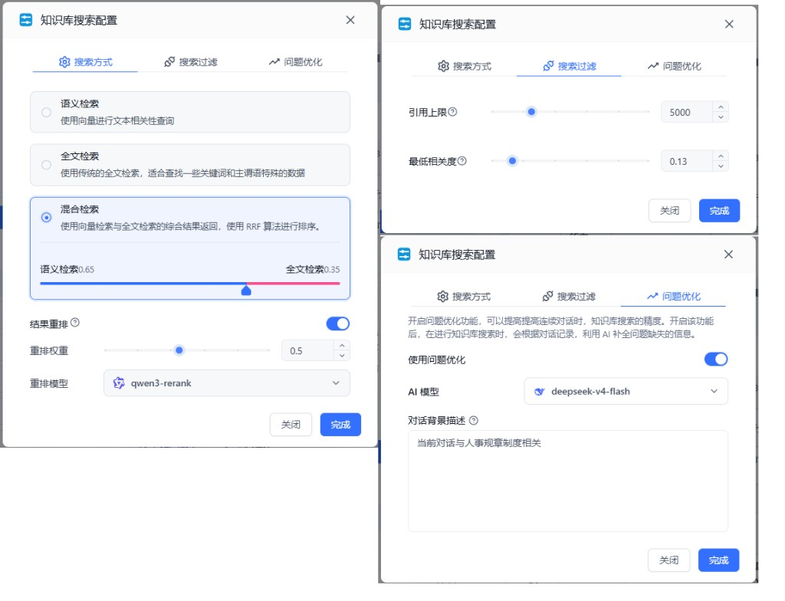
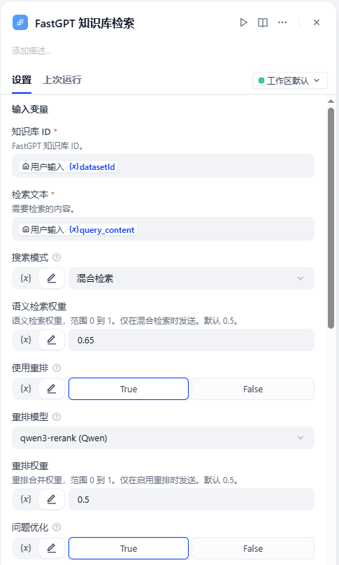
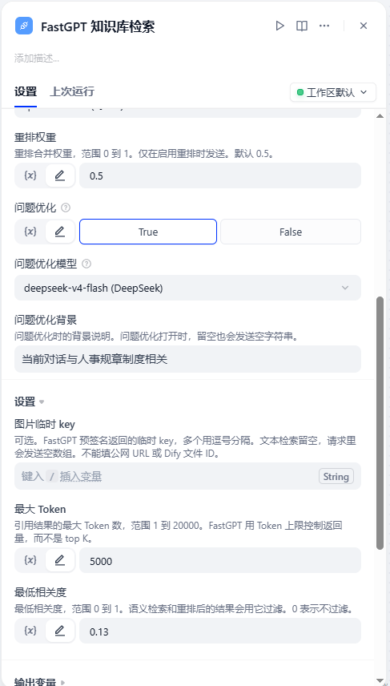
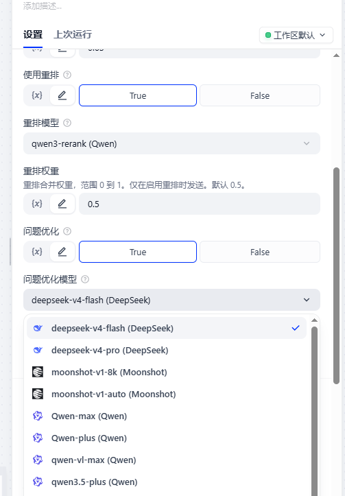

# FastGPT 知识库检索

**作者:** xiaozie-xy  
**版本:** 0.0.1  
**类型:** 工具插件

## 概述

FastGPT 知识库检索是一个 Dify 工具插件。调用 FastGPT 的 [searchTest](https://cloud.fastgpt.cn/apidoc/devapi#tag/%E7%9F%A5%E8%AF%86%E5%BA%93%E7%AE%A1%E7%90%86/POST/core/dataset/searchTest) 接口检索分段。

为想在 Dify 中使用 FastGPT 知识库的开发者提供便利，检索参数对齐 FastGPT 知识库测试页实际提交的字段。

## 功能特性

- **运行时选择知识库**：每次检索哪一个库，由传入的 `datasetId` 决定。
- **搜索模式**：语义检索、全文检索或混合检索。
- **语义检索权重**：混合检索时可设置向量权重。
- **引用上限与最低相关度**：`limit` 是 Token 上限，不是 top K；可用 `similarity` 过滤结果。
- **重排**：可开关重排，并选择 FastGPT 账号下的重排模型与权重。关闭时不发送重排模型和权重。
- **问题优化**：检索前可用模型改写问题，并填写背景说明。关闭时不发送问题优化模型和背景。
- **图片临时 key**：可选。仅接受 FastGPT 预签名返回的临时 key。
- **两个输出**：`result` 是分段列表，`context` 是拼好的文本。

## 安装方法

在 Dify 的插件页面上传 `fastgpt_knowledge-0.0.1.difypkg`。自部署环境如果拒绝未签名的本地包，先在部署配置中关闭插件签名强制校验，再重新安装。装好后填写 FastGPT 站点地址和 API Key。

## 配置说明

### 提供者凭证

插件只需授权一次。这把密钥和应用发布页里的密钥不是同一把。

| 参数 | 说明 | 必填 |
|------|------|:----:|
| `api_base` | FastGPT 站点地址，不要带 `/api`。云端填 `https://cloud.fastgpt.cn`。自部署填自己的站点地址。插件请求 `{地址}/api/core/dataset/searchTest`。 | 是 |
| `api_key` | 在「账号 → Api 密钥」中生成。说明见 [如何获取 API Key](https://doc.fastgpt.io/zh-CN/openapi/intro#%E5%A6%82%E4%BD%95%E8%8E%B7%E5%8F%96-api-key)。账号须是该知识库的创建者或协作者，否则检索会返回 `unAuthDataset`。不要使用应用发布页里的密钥。 | 是 |

### 工具参数

**变量绑定**

| 参数 | 中文名 | 说明 | 必填 |
|------|--------|------|:----:|
| `datasetId` | 知识库 ID | 本次要检索的 FastGPT 知识库 ID。 | 是 |
| `text` | 检索文本 | 需要检索的内容。 | 是 |
| `searchMode` | 搜索模式 | `embedding` 语义、`fullTextRecall` 全文、`mixedRecall` 混合。 | 否 |
| `embeddingWeight` | 语义检索权重 | 范围 0 到 1。仅在混合检索时发送。 | 否 |
| `usingReRank` | 使用重排 | 是否让 FastGPT 重排结果。关闭时不发送重排模型和权重。 | 否 |
| `rerankModelId` | 重排模型 | 从已保存账号的重排模型中选择。仅在启用重排时发送。 | 否 |
| `rerankWeight` | 重排权重 | 范围 0 到 1。仅在启用重排时发送，默认 0.5。 | 否 |
| `datasetSearchUsingExtensionQuery` | 问题优化 | 检索前是否优化问题。关闭时不发送问题优化模型和背景。 | 否 |
| `datasetSearchExtensionModelId` | 问题优化模型 | 从已保存账号的语言模型中选择。仅在启用问题优化时发送。 | 否 |
| `datasetSearchExtensionBg` | 问题优化背景 | 问题优化时的背景说明。打开问题优化时，留空也会发送空字符串。 | 否 |

**节点上配置**

| 参数 | 中文名 | 说明 | 默认 |
|------|--------|------|------|
| `queryImageUrls` | 图片临时 key | FastGPT 预签名返回的临时 key，多个用逗号分隔。文本检索留空，请求里发送 `[]`。不能填公网 URL 或 Dify 文件 ID。 | 留空 |
| `limit` | 最大 Token | 引用结果的最大 Token 数，范围 1 到 20000。 | 5000 |
| `similarity` | 最低相关度 | 范围 0 到 1。语义检索和重排后的结果会用它过滤。0 表示不过滤。 | 0 |

请先保存 FastGPT 地址和 API Key，保存成功后再打开模型下拉。插件会请求 `GET /api/core/ai/model/catalog`，选中后提交 FastGPT 的模型 ID。若凭证尚未保存，下拉中会显示「请先填写并保存 FastGPT 地址和 API Key」。

## 界面示例

参数与 FastGPT 知识库测试页的「知识库搜索配置」对齐，例如搜索方式、引用上限、最低相关度、重排和问题优化：



在 Dify 工作流节点里，知识库 ID、检索文本、搜索模式、语义检索权重、重排与问题优化等放在「输入变量」：



图片临时 key、最大 Token、最低相关度在节点下方的「设置」里：



重排模型和问题优化模型使用动态下拉，从已保存的 FastGPT 账号拉取模型列表：



当前 Dify 在工具节点的「设置」区（`form: form`）打开 `dynamic-select` 时，请求可能带不上已保存的插件凭证，下拉无法正常加载。因此重排模型、问题优化模型暂时放在「输入变量」区（`form: llm`）。Dify 合并相关修复后，这些模型选择有可能迁回「设置」区。

## 使用示例

语义检索一个知识库：

```text
datasetId: 你的知识库 ID
text: 需要检索的内容
searchMode: embedding
limit: 5000
similarity: 0
```

混合检索，并打开重排与问题优化：

```text
searchMode: mixedRecall
embeddingWeight: 0.65
usingReRank: true
rerankModelId: （从下拉选择）
rerankWeight: 0.5
datasetSearchUsingExtensionQuery: true
datasetSearchExtensionModelId: （从下拉选择）
datasetSearchExtensionBg: 当前对话与人事规章制度相关
limit: 5000
similarity: 0.13
```

## 工作流程

```text
开始节点
  datasetId = 本轮任务对应的 FastGPT 知识库 ID
  text      = 需要检索的内容
        |
        v
FastGPT 知识库检索
  按 searchMode / 重排 / 问题优化等组装 searchTest 请求
  调用 FastGPT {地址}/api/core/dataset/searchTest
        |
        v
下游 LLM
  使用 context 作为检索到的文本
  需要分数、来源、分段明细时使用 result
```

建库、上传和索引由 FastGPT 侧完成。调用前目标知识库需已可检索。

## 输出说明

| 输出 | 说明 |
|------|------|
| `result` | 按 FastGPT 返回顺序排列的分段。每项包含 `content`、`q`、`a`、`score`、`score_details`、`id`、`dataset_id`、`collection_id`、`source_name`、`source_id`、`chunk_index`、`update_time`、`position`。文档分段通常没有 `a`。`score` 优先取重排分，其次是语义、全文和 RRF。`score_details` 保留每项的 `type`、`value` 和 `index`。全文分数可以大于 1。 |
| `context` | 把各分段的 `content` 用空行拼成一段文本，便于直接交给 LLM。 |
| 文本消息 | 与 `context` 相同。没有命中时，文本说明没有检索到分段。 |

JSON 消息还会带上 FastGPT 返回的 `duration`、`limit`、`searchMode`、`usingReRank`、`similarity` 和 `queryExtensionModel`。

## 限制

- `limit` 是 Token 上限，这个接口不用 top K。
- `queryImageUrls` 只能填 FastGPT 预签名返回的临时 key，不能填公网 URL 或 Dify 文件 ID。
- 语义检索权重仅在混合检索时发送；重排 / 问题优化关闭时不发送对应模型和权重（或背景）。
- 账号既不是知识库创建者也不是协作者时，检索会返回 `unAuthDataset`。
- 本插件不负责在 FastGPT 中创建、上传或删除知识库。
- 模型动态下拉依赖已保存的插件凭证；设置区暂无法可靠触发动态下拉，故模型选择暂放在输入变量区。

## 环境要求

- Dify 1.17.1 及以上
- 由该知识库的创建者或协作者生成的 FastGPT API Key
- Python 3.12

## 开源协议

[Apache License 2.0](https://github.com/xiaozie-xy/dify_plugin_fastgpt_knowledge/blob/main/LICENSE)。

## 相关链接

- [源码仓库](https://github.com/xiaozie-xy/dify_plugin_fastgpt_knowledge)
- [FastGPT 知识库接口](https://cloud.fastgpt.cn/apidoc/devapi#tag/%E7%9F%A5%E8%AF%86%E5%BA%93%E7%AE%A1%E7%90%86/POST/core/dataset/searchTest)
- [如何获取 API Key](https://doc.fastgpt.io/zh-CN/openapi/intro#%E5%A6%82%E4%BD%95%E8%8E%B7%E5%8F%96-api-key)
- [Dify](https://dify.ai/)
